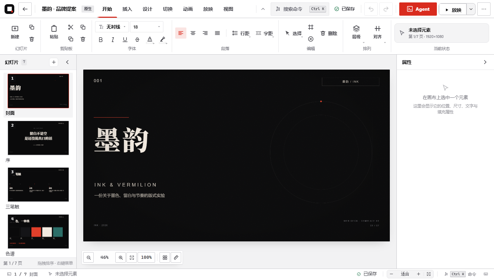

# WebDeck Studio · 页演

> 一个「网页演播工作台」：套了 PowerPoint 的操作界面，但底层是**真正的网页**——
> 导入的 HTML / CSS / JS / 动效原样保留，编辑直接作用于网页 DOM。
> 没有「兼容模式 / 原生模式」两套东西；创建、导入、编辑、放映，都是一份网页。
> （例如 `samples/motion-100`、`samples/bloom-live` 这类手写动效网页）。




---

## ✨ 功能总览

### 文件库
- 工程卡片 + 搜索、排序、来源徽章（**网页 / 导入 / 模板**）
- 新建（4 套设计模板：**空白（1 页纯白空画布，真正从零开始）** / 墨韵 / 繁花 / 素白）、导入、重命名、复制、导出 HTML、删除
- **导入即编辑，只有一种工程**：不转换、不改写原稿 `index.html`，原 JS/CSS/运行时/动画全部保留；
  编辑结果以**补丁层**保存（`.raw-edits.json`），放映/导出时自动应用补丁
- 预设动画、时间线、转场叠加、点击交互由注入的**网页运行时**作用于原稿元素（不需要改造成固定模板结构）；
  「加入时间线」的元素用稳定 id（页序号 + DOM 路径）定位，重开工程仍能命中
- 不再提供「转换为可编辑工程」入口：导入就是最终形态，避免两套模式互相打架
- 内置示例：`100 MOTION STUDIES`（100 页动效清单）、`BLOOM · 绽放`（8 页花开动画）；示例导入默认 raw，保留原动效

### 动画时间线 2.0（独立于分页）
- 画布工具条「时间线」/ 放映标签打开底部面板：**跨页全局轨道，不绑定单页**；面板高度可拖拽，打开时画布自动让位
- **多条动画线**：元素轨道 + 贯穿层轨道；每条任意关键帧（时间 + 不透明度 / 偏移 X·Y / 缩放 / 旋转 / 模糊），可拖动关键帧改时间、双击轨道空白加帧
- **分页状态**：轨道在每个分页切换点自动生成关键帧；「分页状态」弹窗逐页编辑图层位置/效果（X / Y / 缩放 / 不透明度），或抓取画布当前值
- **贯穿层生成器**：屏闪 / 飞入 / 光带 / 快门 / 黑场，一键生成贯穿全片、每次切页都触发的图层 + 轨道
- 播放头拖动时画布跟随分页；「跟随分页」决定切页是否把播放头对齐到该页起点；「放映自动播放」让时间线在放映时自动跑
- 运行时用 `translate / rotate / scale` 独立属性，和元素自身 transform 叠加，不会把已经摆好的位置覆盖掉
- 网页运行时：贯穿层在编辑/放映都可见；预设动画在页面切换时自动播放，不要求原稿有 `wpx-*` 结构
- Agent 可用 `deck_set_timeline` 直接生成多轨时间线（HTML 自由度优先，不受 PPT 限制）

### 编辑器（仿 PowerPoint）
- **52px 单行顶栏**：品牌/文件名/来源徽章 + 8 个 Ribbon 标签（开始/插入/设计/切换/动画/放映/视图/Agent）+ 搜索/保存/撤销重做/**醒目的 Agent 主按钮**/放映/更多；
  功能区内容单独一行（104px），双击标签可折叠
- **纯白 / 纯黑中性色**（无暖色底、无颗粒噪点、**界面零渐变**）、2px 锐角、坚实粗描边 SVG 图标、大号实心按钮；UI 基础字号 14px、紧凑密度
- 左侧幻灯片缩略图（220px、虚拟化、拖拽排序、右键菜单）、中间真实 deck 画布（缩放 / 网格 / 参考线）、
  右侧属性面板与 Agent 侧栏、底部状态栏
- **选择 / 拖动 / 8 向缩放 / 旋转**，双击编辑文字，方向键微调，Delete 删除，Ctrl+D 复制，拖入/粘贴图片
- 导入网页里点击会**精确命中**标题 / 段落 / 图片 / 链接（h1、p、img…），而不是整页 wrapper；元素 id 跨会话稳定
- **鼠标逻辑**：编辑画布左键只选中、绝不翻页；右键永远是自己的菜单（浏览器默认菜单被拦截）。
  元素右键菜单：编辑文字 / 编辑 HTML / AI 重做 / 图层（置顶·上移·下移·置底）/ 复制·粘贴·原位复制·删除 / **点击行为**（下一页·上一页·跳页·链接·重播·时间线）/ 加入时间线轨道 / 复制到所有页 / 属性面板；
  空白处右键：插入 / 粘贴 / 全选 / 时间线 / 网格 / 适应窗口 / 翻页 / 让 AI 重做这一页
- 文字排版：字体、字号、颜色、高亮、粗斜下划线、对齐、行距、字距
- 插入：文本框、图片（上传/URL/拖放）、形状（矩形/圆/椭圆/线/三角/箭头/星形/菱形/六边形）、图标、HTML 代码块
- **动效库 40 个预设**（文字/形状/循环/强调/退场）+ **24 种页面切换**（含 shutter / mosaic / clock / fold）；悬停实时预览、开始方式/时长/延迟/缓动/循环、
  当前页动画窗格、一键预览
- **原稿转场完整保留**：导入转换会捕获原稿每页的切换动画（WAAPI 快照），放映时按原效果重放；
  捕获不到的页按原稿 HUD 文案回退到对应内置切换（不是一律淡入淡出）
- **转场叠加（不是 PPT）**：每个切换可再叠一层白闪 / 黑闪 / 色闪 / 飞入 / 扫光 / 横线，叠加层不替代原切换；
  切换面板「转场」下拉即选。想更自由就直接用时间线做贯穿层
- **放映交互**：左键可设为「翻页 / 只播动画 / 不响应」；右键打开自定义放映菜单（上一页 / 下一页 / 页码网格 / 全屏 / 重播 / 时间线 / 左键模式 / 退出），
  网页默认菜单不会再出现；元素可绑定点击行为，点击元素执行动作而不翻页
- **自定义动效 / 转场**：预设不够时可直接写 CSS / JS / WAAPI（`__WPX__.registerTransition`），
  Agent 可用 `deck_set_custom_transition` 一步注册并应用；网页级效果不受 PPT 条框限制
- 入场时序：动画首帧在页面显示前预置，显示后同帧播放，避免元素“先显示终态再抽搐回首帧”
- 设计：8 套主题、字体组合、背景、颗粒 / 暗角
- **逐次修改记录**：每次修改自动入历史，可单条撤回、可「回到任意时刻」；自动保存到磁盘（防抖 800ms）
- 放映（新窗口全屏、`#n` 深链、键盘/点击/滚轮/触摸、进度 HUD）、导出 HTML、打印 / 另存 PDF

### AI Agent（右侧栏，Codex 风格，全高）
- 右侧栏占满窗口全高（含顶栏区域），打开时左侧界面让出宽度
- **输入框底部工具条**：模型选择器（能力徽章）+ **思考强度**（自动/低/中/高 → `reasoning_effort`）+ **工作权限**
  （只读 / 可编辑 / 完全访问，按权限过滤工具：8 / 26 / 32 个）+ **联网开关**（开启后 Agent 可调用 `web_search`）+
  联网设置（齿轮，独立弹窗）+ 附件 + 发送/停止
- **输出上限与自动续写**：默认输出预算 **65536（64K）**，高级设置可调（DeepSeek 文档最大 384K）；
  当 `finish_reason=length` 或流意外结束时自动续写（最多 4 次），不再输出到一半直接停
- OpenCode Go 的 `x-opencode-session` 会做 ASCII 转义（工程 id 含中文时不再触发 ByteString 错误）
- 消息区顶部新增「一键收起」按钮：同时折叠/展开所有工具调用卡片与思考过程（Codex 式）
- **联网搜索**：输入框底部「联网」开关，开启后 Agent 可调用 `web_search` 工具（DeepSeek Search / Tavily，二选一配置）；
  独立「联网搜索设置」弹窗（服务商 / API Key / Base URL / 结果数 / 测试连接），与 AI 模型设置分开
- 每个工程独立会话，持久化；流式输出、思考过程折叠、Markdown 渲染、工具调用卡片、token 用量；无提示性小字
- **39 个内置工具**：读工程/页/元素、改文字/样式/几何、插入文本/图片/形状/HTML、增删复制移动页、
  设置动画/切换/主题/全局 CSS/JS、自定义转场、时间线、转场叠加、元素点击交互、直接写文件（`file_read/file_write`）
- **所有 UI 功能都有命令接口**：`app_list_commands` 列出 117 条编辑器命令，`app_run_command` 直接执行任意命令；
  界面里输入 `/` 打开同一份命令清单
- **计划清单**：`update_plan` 让 Agent 先列 3–8 步，界面显示勾选进度
- 系统提示词按「当前工程 / 页面 / 选中元素 / 能力 / 命令目录 / 技能」注入，不再有模式分支
- 每次工具修改都进入历史，可在工具卡片上一键「撤回」
- 双 API 预设：**DeepSeek**（`https://api.deepseek.com/v1`）与 **OpenCode Go**（`https://opencode.ai/zen/go/v1`），
  支持自定义 OpenAI 兼容端点；**一键获取模型**并自动识别能力；Key 只存服务端
- **AI 设置**：Provider 分页标签（一次一个，内置只填 API Key），Base URL/模型 id 收进「高级」；
  底部「高级设置」折叠：温度（默认 0.7）、上下文上限（默认 100M tokens）、最大输出、流式、技能管理
- 新增工具：`deck_set_timeline`（跨页时间线）、`deck_set_transition_fx`（转场叠加）、`deck_set_element_action`（元素点击交互）、`deck_set_deck_flags` 的 `mouseMode`
- 内置 6 个前端技能（动效设计 / 版式与字体 / 配色 / 演示叙事 / Deck 代码规范 / 图片处理），可在高级设置中开关
- 系统提示词内置：视觉展示定位（唯一约束是分页呈现）、deck 格式、工具规范、动效目录、设计规范、
  自定义动效/转场代码示例、工作权限规则、安全边界；欢迎提示为动效向（逐字入场/转场/3D 翻转/粒子描边）

---

## 🚀 快速开始

环境：Node.js ≥ 20（无第三方依赖）。

```bash
cd D:\DSHPj\pptweb
node server.mjs
# → http://127.0.0.1:4321
```

- 端口默认 **4321**（可用 `PORT` 环境变量覆盖；4310 已被本机其它程序占用，勿用）。
- 首次打开是文件库；点「新建」选模板，或「导入」上传 / 浏览本机 HTML。
- 数据都在本地：`projects/<id>/`（工程）、`data/settings.json`（API Key 等服务端配置）。

### 配置 AI（可选）
1. 点右上角「AI 设置」（或编辑器里 Ctrl+Shift+E 打开 Agent → 未配置模型 → 去设置）。
2. 选择 **DeepSeek** 或 **OpenCode Go**，粘贴 API Key（也可用环境变量 `DEEPSEEK_API_KEY` / `OPENCODE_GO_API_KEY`）。
3. 点「一键获取模型」→ 选择默认模型 → 保存。
4. 回到编辑器打开 Agent（Ctrl+Shift+E），输入需求即可。Agent 支持直接改代码、改版式、加动效，所有修改可撤回。

---

## ⌨️ 快捷键

| 快捷键 | 功能 |
|---|---|
| `Ctrl+S` | 保存 |
| `Ctrl+Z` / `Ctrl+Shift+Z` / `Ctrl+Y` | 撤销 / 重做 |
| `Ctrl+K` | 命令面板（搜索全部命令） |
| `Ctrl+Shift+E` | 打开 / 收起 Agent |
| `Ctrl+D` | 复制选中元素 |
| `Delete` / `Backspace` | 删除选中元素 |
| 方向键 / `Shift`+方向键 | 微调 1px / 10px |
| `F5` / `Shift+F5` | 从头放映 / 从当前页放映 |
| `Esc` | 取消选中 / 关闭弹层 |
| 右键 | 元素菜单 / 画布菜单（编辑时）；放映菜单（放映时） |
| 放映中：`←/→/空格/PgUp/PgDn/Home/End` | 翻页；`F` 全屏；`R` 重播；`A` 自动播放 |

---

## 🧱 技术架构

```
server.mjs              Node 零依赖 HTTP：静态 + 工程 API + 导入 + 缩略图 + AI 代理（SSE）
editor/
  deck-runtime.js/css   deck 运行时（缩放、翻页切换、转场叠加、动效播放、导入页 CSS/WAAPI 重放、放映 HUD/右键菜单/鼠标模式、编辑/缩略图模式）
  web-runtime.js        网页运行时：预设动画、转场叠加、元素动画预览（不要求模板结构）
  present-shell.js      网页放映外壳（右键菜单 + 左键模式 + 元素点击交互，不改原稿）
  timeline-player.js    网页时间线播放器（贯穿层自动创建、跨页跟随、放映自动播放）
  fx-presets.js         40 个动效预设（WAAPI）+ 目录/缓动
  bridge.js             注入 deck iframe 的编辑桥（postMessage RPC：选择/文字/样式/结构/序列化/撤销 op）
  thumb.css             缩略图「动画终态」CSS
app/                    原生 ES Module 前端（无构建）
  js/core/              bus（命令+事件）、store、api、dom、toast、dialog
  js/ui/                标题栏、Ribbon、状态栏、浮层/菜单/tooltip/取色器、命令面板、图标
  js/library/           文件库、新建、导入、HTML→deck 转换（计时器加速 + 逐页捕获 + WAAPI 快照）
  js/editor/            编辑器编排、bridge 客户端、选择/拖拽、文字、插入、属性、缩略图、历史、
                        动效库、切换、主题、放映、导出
  js/agent/             Agent 面板、流式循环、31 工具、系统提示词、技能、模型设置、Markdown
  styles/               base tokens + 各模块样式（深浅色、纯色 + 微颗粒质感）
templates/              4 套新建模板
skills/                 6 个内置技能（markdown）
samples/                内置示例原稿（motion-100 / bloom-live）
projects/               用户工程（运行时生成）
scripts/                qa.mjs（无头 Chrome E2E）、shots.mjs（视觉截图）、mock-ai.mjs（Agent E2E 用 Mock 模型）
docs/SPEC.md            完整架构/接口契约
docs/shots/             QA 与视觉截图
```

### Deck 文件格式（自包含）
每个工程一个 `index.html`，打开即可放映：
`section.wpx-slide[data-transition] > div.wpx-canvas > 元素`；元素用 inline style 定位，
动画写在 `data-wpx-anim` / `data-wpx-anim-params`；导入页保留原 CSS class 与 `data-wpx-waapi` 快照，
运行时给 canvas 加 `.live` 即可重播原稿 CSS 动画。详见 [docs/SPEC.md](docs/SPEC.md)。

### 编辑桥（bridge）
编辑器画布是加载 `/p/<id>/index.html?wpx=edit` 的 iframe；`bridge.js` 在 iframe 内提供
postMessage RPC（选择、文字编辑、样式/几何、插入删除、幻灯片结构、动画、CSS/JS、序列化），
每个修改生成一个可逆 op（`before/after`）发给父窗口入历史；撤销/重做由父窗口回放 op。

### 导入转换
隐藏 iframe 中加载原稿（注入计时器加速器）→ 逐页激活 → `getAnimations().finish()` 取终态 →
捕获每页 HTML + WAAPI 关键帧快照 + 全部 CSS → 组装原生 deck 并内联 runtime。
实测 motion-100（100 页 / 813 个动画快照）约 35s，bloom-live（8 页）约 5s。

---

## 🧪 开发与 QA

```bash
# 语法检查
node --check server.mjs

# 完整 E2E（无头 Chrome + CDP）：文件库 → 编辑器 → 改字/撤销/插入/动画/保存 → 增删页 → 主题 → Agent → 设置
node scripts/qa.mjs

# 追加：导入转换示例（motion-100 / bloom-live）
node scripts/qa.mjs --convert

# 追加：Agent 工具调用 E2E（自动起本地 Mock AI，无需真实 API Key）
node scripts/qa.mjs --agent

# 视觉截图（输出到 docs/shots/final-*.png）
node scripts/shots.mjs
```

QA 产物：`docs/shots/qa-report.json`（步骤/耗时/console error）。

---

## ⚠️ 已知限制

- 导入转换会把「JS 驱动的动效」冻结为静态终态 + 捕获的 WAAPI 快照重放；原稿仍可「放映原稿」保留 100% 动效。
- 多选、组合、图表、视频暂未实现；旋转元素的缩放为近似（松手后自动校正）。
- 网页切页本身由原稿脚本控制，不能替换成预设切换；需要用「转场」叠加或时间线做效果。
- 文字编辑中的自动保存会延后到编辑结束；极端关闭浏览器场景可能丢最后一次未落盘修改。
- Agent 的上下文压缩为截断摘要（不额外调用模型总结）；OpenCode Go 若未点「获取模型」需手动填模型 id。
- 本工具面向本地单机使用（服务只监听 127.0.0.1，无鉴权）。

---

## 📄 License

内部工具 / 示例项目，可自由修改使用。
