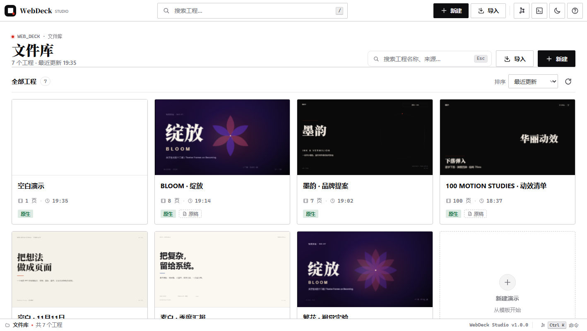

# WebDeck Studio · 页演

> 一个「网页演播工作台」：套了 PowerPoint 的操作界面，但底层是**真正的网页**——
> 导入的 HTML / CSS / JS / 动效原样保留，编辑直接作用于网页 DOM。
> 没有「兼容模式 / 原生模式」两套东西；创建、导入、编辑、放映，都是一份网页。
> （例如 `samples/motion-100`、`samples/bloom-live` 这类手写动效网页）。




---

## ✨ 功能总览

### 文件库
- 操作区使用系统无衬线字体和清晰字号层级，首页大标题保留展示感；界面字体设置不改变演示文稿内容。
- **项目归档**：卡片菜单选择「归档」，在「已归档」中打开、导出或移出归档；文件、素材、对话与版本记录保留，复制得到进行中的新工程。
- 工程卡片 + 搜索、排序、来源徽章（**网页 / 导入 / 模板**）
- 新建（4 套设计模板：**空白（1 页纯白空画布，真正从零开始）** / 墨韵 / 繁花 / 素白）、导入、重命名、复制、导出 HTML、删除
- **导入即编辑，只有一种工程**：不转换、不改写原稿 `index.html`，原 JS/CSS/运行时/动画全部保留；
  编辑结果以**补丁层**保存（`.raw-edits.json`），放映/导出时自动应用补丁
- 预设动画、时间线、转场叠加、点击交互由注入的**网页运行时**作用于原稿元素（不需要改造成固定模板结构）；
  「加入时间线」的元素用稳定 id（页序号 + DOM 路径）定位，重开工程仍能命中
- 不再提供「转换为可编辑工程」入口：导入就是最终形态，避免两套模式互相打架
- 内置示例：`100 MOTION STUDIES`（100 页动效清单）、`BLOOM · 绽放`（8 页花开动画）；示例导入默认 raw，保留原动效

### 动画时间线 2.0（独立于分页）
- 画布工具条「时间线」/ 放映标签打开底部面板：**跨页全局轨道，不绑定单页**；面板高度可拖拽，打开时画布自动让位
- **多条动画线**：元素轨道 + 贯穿层轨道；每条任意关键帧（时间 + 不透明度 / 偏移 X·Y / 缩放 / 旋转 / 模糊），可拖动关键帧改时间、双击轨道空白加帧
- **分页状态**：轨道在每个分页切换点自动生成关键帧；「分页状态」弹窗逐页编辑图层位置/效果（X / Y / 缩放 / 不透明度），或抓取画布当前值
- **贯穿层生成器**：屏闪 / 飞入 / 光带 / 快门 / 黑场，一键生成贯穿全片、每次切页都触发的图层 + 轨道
- 播放头拖动时画布跟随分页；「跟随分页」决定切页是否把播放头对齐到该页起点；「放映自动播放」让时间线在放映时自动跑
- 运行时用 `translate / rotate / scale` 独立属性，和元素自身 transform 叠加，不会把已经摆好的位置覆盖掉
- 网页运行时：贯穿层在编辑/放映都可见；预设动画在页面切换时自动播放，不要求原稿有 `wpx-*` 结构
- Agent 可用 `deck_set_timeline` 直接生成多轨时间线（HTML 自由度优先，不受 PPT 限制）

### 编辑器（仿 PowerPoint）
- **52px 单行顶栏**：品牌/文件名/来源徽章 + 8 个 Ribbon 标签（开始/插入/设计/切换/动画/放映/视图/Agent）+ 搜索/保存/撤销重做/**醒目的 Agent 主按钮**/放映/更多；
  功能区内容单独一行（104px），双击标签可折叠
- **纯白 / 纯黑中性色**（无暖色底、无颗粒噪点、**界面零渐变**）、2px 锐角、坚实粗描边 SVG 图标、大号实心按钮；UI 基础字号 14px、紧凑密度
- 左侧幻灯片缩略图（220px、虚拟化、拖拽排序、右键菜单）、中间真实 deck 画布（缩放 / 网格 / 参考线）、
  右侧属性面板与 Agent 侧栏、底部状态栏
- **选择 / 拖动 / 8 向缩放 / 旋转**，双击编辑文字，方向键微调，Delete 删除，Ctrl+D 复制，拖入/粘贴图片
- 导入网页里点击会**精确命中**标题 / 段落 / 图片 / 链接（h1、p、img…），而不是整页 wrapper；元素 id 跨会话稳定
- **鼠标逻辑**：编辑画布左键只选中、绝不翻页；右键永远是自己的菜单（浏览器默认菜单被拦截）。
  元素右键菜单：编辑文字 / 编辑 HTML / AI 重做 / 图层（置顶·上移·下移·置底）/ 复制·粘贴·原位复制·删除 / **点击行为**（下一页·上一页·跳页·链接·重播·时间线）/ 加入时间线轨道 / 复制到所有页 / 属性面板；
  空白处右键：插入 / 粘贴 / 全选 / 时间线 / 网格 / 适应窗口 / 翻页 / 让 AI 重做这一页
- 文字排版：字体、字号、颜色、高亮、粗斜下划线、对齐、行距、字距
- 插入：文本框、图片（上传/URL/拖放）、形状（矩形/圆/椭圆/线/三角/箭头/星形/菱形/六边形）、图标、HTML 代码块
- **动效库 40 个预设**（文字/形状/循环/强调/退场）+ **24 种页面切换**（含 shutter / mosaic / clock / fold）；悬停实时预览、开始方式/时长/延迟/缓动/循环、
  当前页动画窗格、一键预览
- **原稿转场完整保留**：导入转换会捕获原稿每页的切换动画（WAAPI 快照），放映时按原效果重放；
  捕获不到的页按原稿 HUD 文案回退到对应内置切换（不是一律淡入淡出）
- **转场叠加（不是 PPT）**：每个切换可再叠一层白闪 / 黑闪 / 色闪 / 飞入 / 扫光 / 横线，叠加层不替代原切换；
  切换面板「转场」下拉即选。想更自由就直接用时间线做贯穿层
- **放映交互**：左键可设为「翻页 / 只播动画 / 不响应」；右键打开自定义放映菜单（上一页 / 下一页 / 页码网格 / 全屏 / 重播 / 时间线 / 左键模式 / 退出），
  网页默认菜单不会再出现；元素可绑定点击行为，点击元素执行动作而不翻页
- **自定义动效 / 转场**：预设不够时可直接写 CSS / JS / WAAPI（`__WPX__.registerTransition`），
  Agent 可用 `deck_set_custom_transition` 一步注册并应用；网页级效果不受 PPT 条框限制
- 入场时序：动画首帧在页面显示前预置，显示后同帧播放，避免元素“先显示终态再抽搐回首帧”
- 设计：8 套主题、字体组合、背景、颗粒 / 暗角
- **逐次修改记录**：每次修改自动入历史，可单条撤回、可「回到任意时刻」；自动保存到磁盘（防抖 800ms）
- 放映（新窗口全屏、`#n` 深链、键盘/点击/滚轮/触摸、进度 HUD）、导出 HTML、打印 / 另存 PDF

### AI Agent（全新对话工作台）

- 深浅色与编辑器同步，侧栏可调宽、可充满整个窗口，支持过渡动画与减少动态效果偏好；文件库和编辑器都可以打开。
- 英文设计系统提示词与 10 个英文技能正文，界面和作品仍按用户语言；目录按内容自主决定，支持原创 HTML / SVG / CSS 结构与动画，预设只是起点。
- 支持图片输入的模型可通过 `deck_capture_slide` 查看实际编辑画面（包括未保存修改），读取元素位置与字体，局部精调后再次截图；图片真正进入模型上下文，并随对话保存。极高思考的三角色模式可分别配置设计、实现和检查模型。
- 用户要求构建 3D 时使用内置 Three.js 与 OrbitControls；「插入 → 3D 结构」也可直接创建或修改。支持鼠标旋转、滚轮缩放、右键平移、单指旋转和双指缩放 / 平移；编辑时有独立操控开关，放映时直接交互。使用 3D 的导出 HTML 内置引擎，可离线打开。
- `agent_parallel` 后台运行 2–4 个独立子代理任务，主模型同时继续自己的设计和代码工作，在依赖整合节点通过 `agent_wait` 按需等待。`agent_parallel_status` 即时查看进度，交付前收齐结果并检查实际工程。普通思考使用当前对话模型，极高思考按任务使用三角色配置；界面显示各任务状态、模型和完整输出。停止后继续只恢复未完成任务。
- 作品直接在对话中交付，提供版本预览、放映、编辑和 HTML 导出；历史交付使用当轮保存的源码与素材。
- 对话支持 LaTeX 数学排版与 SVG 图解预览；编辑器「插入」提供公式、SVG 和自动字体入口，保留公式及图解源码供再次编辑。
- **艺术字工坊**（插入 → 艺术字）：50 个预设分七类——花体英文（花体手写 / 哥特 / 高级衬线 / 压缩海报体 / 打字机 / 等宽科技）、中文字形（行楷 / 隶书 / 朱印 / 碑刻 / 圆润 / 琥珀 / 彩云双描）、字体特效（空心描边 / 霓虹 / 烫金 / 金属铬 / 玻璃 / 浮雕 / 立体挤出 / 复古错位 / 贴纸 / 故障风 / 熔金流光 / 镭射幻彩）、纹理填充（胶片颗粒 / 波点 / 斜纹 / 半调网点 / 格纹 / 拉丝金属 / 双色渐变）、阴影（柔和 / 硬边 / 长投影 / 光晕）、填充动效（渐变流动 / 高光扫过 / 液体填充 / 闪耀粒子 / 呼吸辉光 / 逐字弹入 / 翻转 / 波浪 / 字距收拢 / 打字）与汉字笔画（笔画书写 / 笔顺填充 / 部首高亮 / 笔画拆解）。对话框内按 1920×1080 真实比例预览，可调文字、字体、字号、字重、字距、双色、对齐、笔画粗细、逐字间隔与循环。
- 艺术字是**一个可编辑元素**：静态样式写在元素自带的 `<style>` 里，动画用唯一命名关键帧，切到所在页才播放；右键「转成艺术字」可把选中的普通文字直接带入。
- 笔画类使用内置 3755 常用字（含全量 9574 字可选）的 1024 网格笔顺数据，路径直接内联进作品，导出文件不依赖字体、接口或网络；没有数据的字符自动退化为普通文字并在结果中报告。数据来自 hanzi-writer-data（Arphic Public License），可用 `node scripts/pack-hanzi.mjs` 重新生成。
- 思考等级独立选择自动 / 低 / 中 / 高；自动字体根据内容风格和可用字体选择标题、正文组合。

### 新增字体的出处

新增字体由用户提供并已获授权。字体来源为 [Bilibili 用户主页](https://space.bilibili.com/111221629)。原始 TTF 位于 `app/vendor/project-fonts/`，共 23 个字族、35 个去重后的字体文件。

BAT 工作台可在「开始 → 字体」、右侧文字属性及艺术字工坊中选择这些字体，Agent 也可通过 `fonts_list` 查看。BAT 工作台导出的演示 HTML 按实际使用的字族和字重嵌入字体，可离线播放。动态样式的字重无法确定时，会保留相关字族的候选字重。整套字体包通过 BAT 工作台使用，以控制单文件静态工作台的体积。
- 支持保存当前工程为模板，或导入 HTML / ZIP / PPT 模板；模板可重命名、删除、导出 ZIP 并反复创建新工程。
- PPTX 可直接解析为网页文字、图片、形状和表格；旧版 PPT 及「外观优先」导入使用本机 Microsoft PowerPoint。原文件和转换报告保留在工程 original/。
- 正文直接展示 Markdown、列表、表格与代码。一次任务只有一份紧凑操作日志，完成后收成一行；展开可查看参数、返回结果及可撤回的修改。
- 单一输入区支持图片 / PDF / DOCX / PPTX / 文本附件；Enter 发送，Shift+Enter 换行，生成时 Enter 将补充加入队列。输入 `/` 可查应用命令。
- 模型、思考强度和权限在输入区切换；搜索和附件收在 `+` 菜单，历史、新对话、设置、技能、外观与导出在顶栏。
- 对话按工程和会话独立保存，新对话保留旧记录，支持草稿恢复和本机应急备份。原文不再按最后 12 条或 200 条截断。
- 每轮对话前后保存完整工程版本；消息旁「回退到此处」、回复下方「本轮版本」和顶栏「版本历史」支持恢复及命名保存。回退前自动备份；同步回溯会删除当前分支后续消息，需要保留另一种方案时可先创建项目分支。
- BAT 模式的版本回退逐文件校验并恢复，保留素材目录和未变化的文件，兼容 Windows 文件占用。中断时通过事务日志恢复回退前状态；若文件持续被占用，保留备份与日志，释放占用后再次访问工程会继续恢复。
- 接近模型上下文窗口时，分批整理早期记忆；当前任务和原始记录保留。长附件 / 超大工具结果支持分页读取。PDF 未读取范围会明确显示。
- 「API 设置 → 对话模型 → 上下文压缩」可单独指定压缩服务和模型，复用已配置的 API Key，支持从已获取的模型列表选择或手填模型 ID。留空跟随当前对话模型，协作时跟随当前角色。自动压缩按压缩模型自身的窗口分段；失败或停止保留原始消息和已有记忆。BAT 与单文件模式均支持。
- 长度上限自动续写最多 24 次，连续连接失败最多重试 3 次，单次任务最多 256 轮工具调用。达到边界时保留进度并显示继续入口。
- Agent 使用 `deck_compose` 一次最多生成 48 页，可通过 `deck_add_slide` 追加页面。

### 内置浏览器

BAT 工作台在 Agent 输入区的「+ → 内置浏览器」提供网址栏、页面截图、链接和按钮操作。浏览器使用本机安装的 Chrome 或 Edge，也可通过环境变量 `CHROME_PATH` 指定 Chrome 路径。每个对话使用独立的临时浏览会话，支持公开 HTTP(S) 网站以及直接打开 `http://127.0.0.1:端口`。本地浏览会话的请求限于当前打开的协议、地址和端口，公网网页无法通过链接或跳转打开本机服务。

Agent 可以打开联网资料或在线演示，读取渲染后的正文和可操作控件，点击、滚动、后退、刷新并截图。截图会显示在工具记录里，支持视觉的模型可直接查看。需要在演示中复用时，可以将截图存为工程素材。浏览器打开已有网址这一功能无需配置搜索 API，关键词搜索仍由联网搜索功能提供。
- 停止保留正文和成功工具结果，续接从未完成处继续。工具参数不完整时不执行修改，错误不会被伪装成成功结束。
- `app_list_apis` / `app_call_api` 连接网页业务接口，覆盖工程管理、文件 / 素材、时间线 / 配置 / 历史 / 版本、模板 / 技能、模型 / 设置、搜索及预览 / 导出。
- `app_list_commands` / `app_run_command` 连接编辑器命令；权限在实际调用处检查。保留页面 / 元素 / 动效 / 主题 / 代码等专用工具，增加 `file_patch` 精确补丁与 `tool_result_read` 完整结果读取。
- 兼容 OpenAI 风格与 Anthropic 流式 / 非流式响应，支持 DeepSeek、OpenCode Go 和自定义端点；BAT 模式的 API Key 保存在本地服务端，单文件模式保存在浏览器或导出的私有 HTML 中。

实现与验收说明见 [Agent 工作台](docs/AGENT.md)。

---

## 🚀 快速开始

提供两种完整工作台运行方式。数学渲染、SVG 净化、Office XML 和 ZIP 解析均使用内置依赖，无需 CDN。

### Windows 一键启动（本地后端）

安装 [Node.js 20 或更新版本](https://nodejs.org/) 后，双击根目录的 **`一键启动.bat`**（或 `start.bat`）。首次启动自动安装依赖，服务就绪后打开浏览器。保持终端窗口开启，按 Ctrl+C 停止服务。

默认使用 4321 端口；若被其他应用占用会自动选择后续可用端口。重复启动会打开本项目已有的服务，不会关闭其他程序。也可指定端口：

```bat
start.bat --port 4335
```

命令行启动方式：

```bash
cd D:\DSHPj\pptweb
npm install
node server.mjs
# → http://127.0.0.1:4321
```

- 直接执行 `node server.mjs` 时默认端口 **4321**，可用 `PORT` 环境变量覆盖；`npm run launch` 与 BAT 使用同一个自动启动器。
- 首次打开是文件库；点「新建」选模板，或「导入」上传 / 浏览本机 HTML。
- 数据都在本地：`projects/<id>/`（工程）、`data/settings.json`（API Key 等服务端配置）。

### 单个静态 HTML（无需 Node.js 或后端）

双击 **`WebDeck.html`**，或运行 `打开静态工作台.bat`。这是可编辑的完整工作台：工程管理、Agent 对话与工具、版本回退、公式 / SVG、模板、可编辑 PPTX 导入、搜索、生图、放映和 HTML 导出均可使用。

源码仓库不提交生成文件。Windows 下双击 `构建静态工作台.bat` 生成或更新静态版。命令行也可以运行：

```bash
npm install
npm run build:static
```

构建后只需复制 `WebDeck.html` 一个文件即可使用。推荐 Chrome / Edge 桌面版；无需旁边保留源码、Node.js、素材文件夹或本地 HTTP 服务。

- 在「API 设置」中填写对话、搜索、生图服务。API 由浏览器直接调用，服务商必须允许跨域 CORS（从本地打开时可能使用 `Origin: null`）。遇到跨域限制，可使用支持浏览器调用的网关或 BAT 模式。
- 工程、素材、对话、版本及配置自动保存在浏览器 IndexedDB 中，与 BAT 模式的磁盘数据独立。清理浏览器数据或换浏览器前，请点击右下角「单文件工作区」导出备份。
- 「单文件工作区 → 导出私有 HTML」会先保存当前编辑和对话，再把工程、完整历史、模板和 API 密钥内置到新的 HTML。复制此文件到另一台电脑即可继续；新导出的文件使用独立工作区，之后的修改继续保存在当地浏览器中，也可再次导出。
- 「备份 JSON / 导入备份」用于工作区迁移，导入前有替换确认。导出的私有 HTML 和 JSON 备份均包含配置中的密钥，请按私有文件保存。
- 可编辑 PPTX 在浏览器内解析；旧版 `.ppt`、Microsoft PowerPoint 外观优先转换与浏览磁盘目录使用 BAT 模式。导入网页自身引用的第三方在线资源仍需联网。

也可以在构建时显式内置配置（默认构建不读取本机密钥）：

```bash
node scripts/build-static.mjs --settings data/settings.json --output WebDeck-私有.html
```

验证命令：`npm run test:launcher` 检查启动器，`npm run qa:static` 从真实 `file://` 页面验证单文件工作台（仅使用隔离浏览器与模拟 API，不读取真实密钥）。

### 配置 AI（可选）
1. 点右上角「API 设置」，在同一窗口管理「对话模型」「联网搜索」「生图」。
2. 选择 **DeepSeek** 或 **OpenCode Go**，粘贴 API Key（也可用环境变量 `DEEPSEEK_API_KEY` / `OPENCODE_GO_API_KEY`）。
3. 点「获取模型」→ 选择默认模型 → 保存。模型获取失败会显示错误，可在高级选项中手动填写 ID。
4. 回到编辑器打开 Agent（Ctrl+Shift+E），输入需求即可。Agent 支持直接改代码、改版式、加动效；编辑器工具产生的历史操作可撤回。

生图只需在「API 设置 → 生图」填写 API Key、Base URL，模型列表自动获取，优先 GPT 图像模型；未返回列表时默认使用 `gpt-image-1.5`，也可在高级选项中指定服务商模型。尺寸、质量、背景和输出格式由 Agent 按任务选择。生图默认关闭，须用户手动开启并保存；查询模型不会生成图片，取消不会保存任何 API 草稿。搜索连接测试也仅测试当前草稿。

新对话默认启用「Deck 代码规范」「演示叙事」「动效设计」，手动更改会随会话保存。聊天底部的圆环和百分比显示估算上下文用量，悬浮、聚焦或点击可查看系统提示词、工具定义、对话消息三项明细；占比以当前模型上下文窗口（受用户上限约束）计算。

需要视觉精调时，请选择标记为支持图片输入的模型；三角色模式建议为设计和检查角色配置此类模型。截图通过编辑器 DOM 渲染，包含内置 Three.js 的实际画面；跨域图片缺少 CORS、视频、第三方 WebGL 和部分合成效果可能需要另外检查。工具坐标与页面逻辑像素一致，支持按元素或区域放大查看。详见[创作与视觉检查](docs/CREATION.md)及[3D 与并行生成](docs/THREE.md)。

---

## ⌨️ 快捷键

| 快捷键 | 功能 |
|---|---|
| `Ctrl+S` | 保存 |
| `Ctrl+Z` / `Ctrl+Shift+Z` / `Ctrl+Y` | 撤销 / 重做 |
| `Ctrl+K` | 命令面板（搜索全部命令） |
| `Ctrl+Shift+E` | 打开 / 收起 Agent |
| `Ctrl+D` | 复制选中元素 |
| `Delete` / `Backspace` | 删除选中元素 |
| 方向键 / `Shift`+方向键 | 微调 1px / 10px |
| `F5` / `Shift+F5` | 从头放映 / 从当前页放映 |
| `Esc` | 取消选中 / 关闭弹层 |
| 右键 | 元素菜单 / 画布菜单（编辑时）；放映菜单（放映时） |
| 放映中：`←/→/空格/PgUp/PgDn/Home/End` | 翻页；`F` 全屏；`R` 重播；`A` 自动播放 |

---

## 🧱 技术架构

```
server.mjs              Node HTTP：静态 + 工程 / 模板 API + 导入 + 缩略图
server/                 模型流代理（SSE）和原子写入会话存储
editor/
  deck-runtime.js/css   deck 运行时（缩放、翻页切换、转场叠加、动效播放、导入页 CSS/WAAPI 重放、放映 HUD/右键菜单/鼠标模式、编辑/缩略图模式）
  web-runtime.js        网页运行时：预设动画、转场叠加、元素动画预览（不要求模板结构）
  present-shell.js      网页放映外壳（右键菜单 + 左键模式 + 元素点击交互，不改原稿）
  timeline-player.js    网页时间线播放器（贯穿层自动创建、跨页跟随、放映自动播放）
  fx-presets.js         40 个动效预设（WAAPI）+ 目录/缓动
  bridge.js             注入 deck iframe 的编辑桥（postMessage RPC：选择/文字/样式/结构/序列化/撤销 op）
  thumb.css             缩略图「动画终态」CSS
app/                    原生 ES Module 前端（无构建）
  js/core/              bus（命令+事件）、store、api、dom、toast、dialog
  js/ui/                标题栏、Ribbon、状态栏、浮层/菜单/tooltip/取色器、命令面板、图标
  js/library/           文件库、新建、导入、HTML→deck 转换（计时器加速 + 逐页捕获 + WAAPI 快照）
  js/editor/            编辑器编排、bridge 客户端、选择/拖拽、文字、插入、属性、缩略图、历史、
                        动效库、切换、主题、放映、导出
  js/agent/             Agent 工作台、会话运行时、工具与 API 目录、记忆、技能、模型设置、Markdown
  styles/               base tokens + 各模块样式（深浅色、纯色 + 微颗粒质感）
templates/              4 套新建模板
skills/                 6 个内置技能（markdown）
samples/                内置示例原稿（motion-100 / bloom-live）
projects/               用户工程（运行时生成）
scripts/                编辑器 QA、Agent 运行时测试、独立浏览器验收、本地 Mock 模型
docs/SPEC.md            完整架构/接口契约
docs/shots/             QA 与视觉截图
```

### Deck 文件格式（自包含）
每个工程一个 `index.html`，打开即可放映：
`section.wpx-slide[data-transition] > div.wpx-canvas > 元素`；元素用 inline style 定位，
动画写在 `data-wpx-anim` / `data-wpx-anim-params`；导入页保留原 CSS class 与 `data-wpx-waapi` 快照，
运行时给 canvas 加 `.live` 即可重播原稿 CSS 动画。详见 [docs/SPEC.md](docs/SPEC.md)。

### 编辑桥（bridge）
编辑器画布是加载 `/p/<id>/index.html?wpx=edit` 的 iframe；`bridge.js` 在 iframe 内提供
postMessage RPC（选择、文字编辑、样式/几何、插入删除、幻灯片结构、动画、CSS/JS、序列化），
每个修改生成一个可逆 op（`before/after`）发给父窗口入历史；撤销/重做由父窗口回放 op。

### 导入转换
隐藏 iframe 中加载原稿（注入计时器加速器）→ 逐页激活 → `getAnimations().finish()` 取终态 →
捕获每页 HTML + WAAPI 关键帧快照 + 全部 CSS → 组装原生 deck 并内联 runtime。
实测 motion-100（100 页 / 813 个动画快照）约 35s，bloom-live（8 页）约 5s。

---

## 🧪 开发与 QA

```bash
# 语法检查
node --check server.mjs

# 完整 E2E（无头 Chrome + CDP）：文件库 → 编辑器 → 改字/撤销/插入/动画/保存 → 增删页 → 主题 → Agent → 设置
node scripts/qa.mjs

# 追加：导入转换示例（motion-100 / bloom-live）
node scripts/qa.mjs --convert

# Agent 运行时回归：SSE、恢复、上下文、权限、持久化
npm run test:agent

# 数学、字体、PPTX、模板与离线资源回归
npm run test:authoring

# Agent 浏览器验收：独立服务 / 数据 / Mock 模型，无需真实 API Key
npm run qa:agent

# 视觉截图（输出到 docs/shots/final-*.png）
node scripts/shots.mjs
```

QA 产物：`docs/shots/qa-report.json`（步骤/耗时/console error）。

---

## ⚠️ 已知限制

- 导入转换会把「JS 驱动的动效」冻结为静态终态 + 捕获的 WAAPI 快照重放；原稿仍可「放映原稿」保留 100% 动效。
- 多选、组合、图表、视频暂未实现；旋转元素的缩放为近似（松手后自动校正）。
- 网页切页本身由原稿脚本控制，不能替换成预设切换；需要用「转场」叠加或时间线做效果。
- 文字编辑中的自动保存会延后到编辑结束；极端关闭浏览器场景可能丢最后一次未落盘修改。
- Agent 的理解、规划和执行质量取决于所配置模型；服务不可用或当前任务超过上下文窗口时，会显示原因并保留记录。OpenCode Go 若未点「获取模型」需手动填模型 id。
- 本工具面向本地单机使用（服务只监听 127.0.0.1，无鉴权）。
- PPT 可编辑解析不保证复刻全部 Office 特性：复杂图表按缓存数据重绘，SmartArt / OLE / 自定义曲线 / Office 数学对象及动画可能需要调整，具体见导入报告。外观优先将每页变成图片，不能单独编辑原有文字和形状。

---

## 📄 License

内部工具 / 示例项目，可自由修改使用。


## 页面知识表达与创作增强

- 制作页面支持 LaTeX 公式与 SVG 讲解，保留源码，放映与离线 HTML 导出可用。
- 内置 Frontend Slides / Anthropic PPTX 改编技能与章节结构技能，提供花瓣、轨道、阶梯动画目录；新增「知识花园」示例模板。
- 「API 设置 → 生图」可接入图像模型。默认关闭，需手动开启；生成后只保存到 `assets/chats/<对话ID>/`，返回素材路径，不会自动切页或插入页面。需要使用时由 Agent 单独调用插图工具，决定目标页、位置和尺寸。
- 元素 / 页面右键 AI 重做先填写要求，确认后发送。

详细说明与来源：[创作能力](docs/CREATION.md)。验证：`npm run test:authoring`、`npm run qa:authoring`。

字号支持精确像素和局部文字选择，格式修改可立即 Ctrl+Z / Ctrl+Y；双击画布空白可插入文本框并直接输入。「开始」栏提供两行段落工具和放映入口。

时间线支持可编辑的飞入文字、图片、选中元素副本与 HTML / SVG 特效。可调整方向、尺寸、颜色、时长与关键帧 JSON，也可从时间线的 Agent 按钮填写需求，让模型生成新特效；轨道内容随工程、版本和导出保存。

导出的 HTML 内置左下角半透明放映工具栏：画笔、橡皮、显示鼠标、前后页、全屏与退出，支持鼠标和触摸、按页保存笔迹、撤销笔迹与清除当前页。默认隐藏鼠标；打开时尝试全屏，浏览器限制时会在首次点击或触摸后进入。快捷键：P 画笔、E 橡皮、V 鼠标、F 全屏、Esc 退出。验证：`npm run qa:editor`。

演示 HTML 导出按实际依赖打包：共享分析器检查页面、原稿编辑补丁、时间线内容、本地脚本和样式，只保留使用的内置动画、转场及叠加特效；没有 3D、公式或时间线时不带相应运行时。重复公式样式只内嵌一次，字体采用 WOFF2 并筛除未引用的字族。自定义代码不改写，遇到动态生成内容、动态样式或无法分析的脚本，会保留可能需要的依赖。BAT、静态工作台、历史版本导出使用相同规则，编辑预览保留完整能力。每个演示导出附带 `wds-export-manifest` JSON，记录保留的功能、动画、字体与保守回退原因，便于排查体积。`WebDeck.html` 是包含完整编辑能力的工作台，与按需精简的演示 HTML 不同。验证：`npm run test:export`。

HTML / SVG 元素在右侧「布局」中新增「整体绝对大小」，按像素调整可见宽高，内部文字和图形一起缩放，默认锁定比例，支持撤销、重做与保存导出。Agent 的 `deck_resize_element` 可用 `absolute:true` 和 `keepRatio` 调用同一能力。

Agent 按执行顺序穿插展示文字说明与工具调用。完成后，中间文字、思考和工具统一收起，最终答复与交付卡片保持可见；展开可查看完整过程，刷新后保留记录。

在「API 设置 → 对话模型 → 子代理协作」配置「设计与关键代码」「代码实现」「检查」三个角色的服务与模型，可自动获取候选模型，也可输入模型 ID；留空跟随当前聊天默认模型。聊天思考强度选择「极高」即启用三角色协作：设计拆分任务并完成关键代码，实现代理完成各部分代码，检查代理只读核对实际工程，可退回设计或实现继续修改，通过后由设计代理整理最终交付。角色依次交接，共享会话、工程工具和版本记录，支持停止与续接；后端与单文件静态模式均可使用。验证：`npm run test:agent`、`npm run qa:editor`、`npm run qa:static`。

「极高」模式隐藏普通聊天模型选择，显示「三模型协作」配置入口；切回其它思考强度恢复普通模型选择。三个角色已明确配置服务与模型时，无需另选普通聊天模型；续接沿用该轮保存的角色配置。检查模型若只输出文字，运行时会要求实际读取工程并给出交接结论；不支持工具调用时明确暂停，保留进度供调整配置后继续。

SVG 精细绘图支持并行子代理：复杂新图或重绘会分派完整绘图与核查任务，共享坐标、部件、图层、ID 前缀和视觉规范，主模型继续独立页面工作。绘图代理必须返回完整 SVG，提纲和残缺 XML 会自动要求补全。内置英文指导详细覆盖构图、几何、内部细节、剖面/局部放大、科学标注、视觉细节和多模态放大检查；Three.js 同时加强部件建模、连接、材质灯光、相机及实际验收标准。也可在技能管理开启「SVG 精细图解」。小范围颜色/文字/位置修订保持局部处理。实现与质量检查边界见 [3D 与 SVG 并行制作](docs/THREE.md)。验证：`npm run test:agent`、`npm run qa:parallel`。


### 元素收藏

画布中右键元素 →「收藏元素」，或在「插入」栏点击「收藏选中」。在任意工程打开「元素收藏」即可搜索、预览、插入、重命名和删除。收藏会保存计算后的样式，并内嵌用到的图片、字体；插入的是独立副本，支持撤销、重做，删除原工程或收藏不会移除已插入的副本。动态脚本与整页时间线不随单个元素复制。

聊天输入区「+」→「收藏元素」，或在收藏库点击「添加到聊天」，会把完整素材加入待发送附件，可补充要求后再发送。Agent 可读取收藏并调用 `favorites.insert` 插入当前页面。

BAT 模式收藏保存在 `data/elements/`；单文件模式保存在浏览器中，并随工作区 JSON 备份、私有 HTML 一起迁移。验证：`npm run test:favorites`、`npm run qa:agent`、`npm run qa:static`。

### 系统提示词结构

系统提示词按执行规则、创作规范、工具能力、启用的 Skill 与用户偏好、验收要求、当前项目状态分区注入。协作角色和并行子代理的职责归入执行规则；原有设计指导内容保留，按开启的模式和当前任务选择性注入。

聊天输入框底部的「Skill」显示已启用数量，点击即可搜索和连续勾选技能，或恢复内置默认项。内置技能随当前对话保存，自定义技能开关保存在用户设置中；可通过「管理 / 导入」添加自己的 Skill。生成期间暂时禁用调整，避免改变正在执行的任务配置。

### 华丽动效与原创设计

聊天输入区开启「华丽动效」后，主模型、协作角色与子代理会获得额外英文设计指导：紧扣用户描述和主题，自主发展复杂而连贯的视觉方案，重点设计排版、字体与艺术字、流畅的元素动画、原创切换、多轨时间线、背景及交互。Agent 会主动发现并组合适合任务的编辑器接口与工具；生图仍需用户手动启用。前景内容保持独立可编辑，SVG、3D 等完整作品合理分组。关闭该模式后不注入这部分指导。

### 超限聊天自动压缩

已超限的旧聊天可直接点击「继续」。压缩支持当前单轮的长回答和完整工具调用批次，单独选用的压缩模型会按自己的窗口分段处理；旧记忆过长也会重新整理。模型服务返回上下文超限时会自动缩减请求预算、压缩并重试。原始消息、代码和工具结果完整保留，超长原文可分页读取；中断压缩不会提交半成品记忆。

自动压缩默认生效，无需手动开启。每轮请求前检查输入预算；窗口紧张时，会根据系统指令和工具定义的实际占用适当降低单次输出额度，为工作记忆留出空间，再压缩历史并继续。主模型与并行子代理采用相同规则；已完成的工具操作不会因压缩而重新执行。可在「API 设置 → 对话模型 → 上下文压缩」指定压缩模型，留空使用当前工作模型。

同时检查请求的实际字节数，避免图片 base64 等内容在 token 用量未满时触发「请求体过大」。收到 HTTP 413 后自动缩小请求并压缩重试，压缩模型也会分段并降低单次请求大小；原始附件和消息继续保留。因大小限制未传给模型的图片会明确标记，避免模型误称已查看。

### WebDAV 云端备份

在「API 设置 → 云端备份」填写 WebDAV 地址和账号，启用后默认每天自动备份，也可立即备份、查看、下载和恢复。备份包含工程、素材、对话、历史版本、模板及元素收藏；API 密钥默认排除。恢复前自动保存本地副本。BAT 需保持后端运行，单文件需保持网页打开，错过会在下次启动补做。详见 [配置、备份范围与恢复规则](docs/WEBDAV.md)。


### 自定义指令与 Skill

在「API 设置 → 指令与 Skill」或聊天输入区「+ → 自定义指令与 Skill」中，追加自己的系统提示词，或新建、编辑、启停、移除个人 Skill。内置系统提示词及内置 Skill 正文保持只读；个人内容单独保存，启用后应用于所有会话后续请求和子代理。

支持导入一个或多个 Markdown 文件，以及挂载含 `SKILL.md` 的文件夹。文件夹按每个 `SKILL.md` 拆分 Skill，并保存同目录的文本参考文件（含子目录）；图片和二进制文件不导入，参考脚本仅作为文本，不自动执行。挂载保存的是副本，源文件更新后需重新导入。个人指令和 Skill 合计最多 2MB；启用的内容计入模型上下文。

BAT 模式保存到本地 `data/settings.json`，单文件静态模式保存到当前浏览器工作区。验证：`npm run test:instructions`。

在聊天底部的 Skill 面板中，可分别为内置或自定义 Skill 勾选「强制」。该选项保存在用户设置里，仅在对应 Skill 已启用时生效。每次主模型和子代理请求都会读取其完整正文并列为必读，读取失败时会暂停并显示原因。以前开启过全局强制的配置继续生效，可逐项关闭。

### 对话回溯与项目分支

消息旁的「回退到此处」恢复到这一轮之前，并将该轮要求放回输入框；助手回复下的「回溯到此处」恢复到这一轮完成后的状态。确认后，同步恢复页面、素材、动画、编辑历史和对话，后续消息从当前分支删除，压缩记忆也恢复到对应节点。回溯前保留恢复版本。新对话的每轮前后都会保存快照；旧消息只有已有快照的节点能准确回溯。

使用消息旁的「从此处分支」，或「对话选项 → 项目分支」，可从历史节点或当前状态创建命名分支。同一项目内各分支保存独立对话和完整工程状态；切换时先保存当前分支，再恢复目标分支。分支可重命名；项目内的「新对话」也会保留当前工程状态并建立一个空对话分支。分支切换失败时自动回滚，遇到文件占用则保留恢复日志供下次恢复。BAT 与单文件静态模式均支持。验证：`npm run test:branches`。
